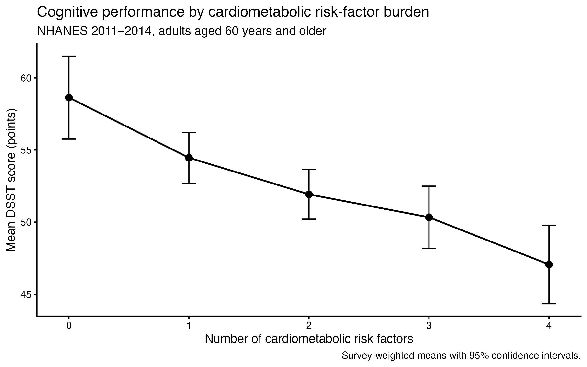
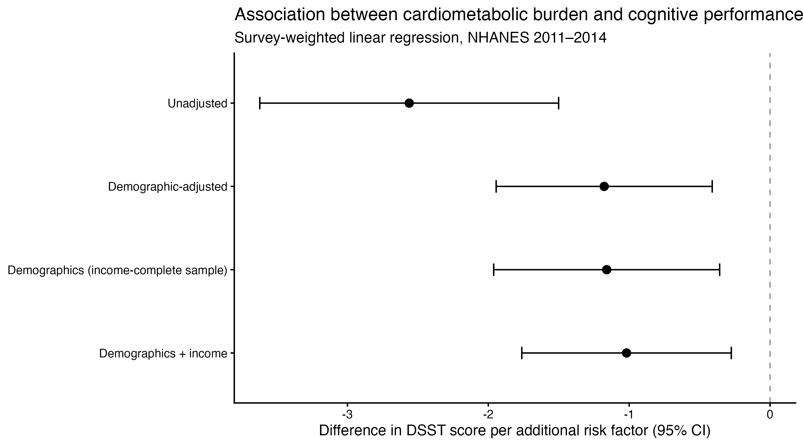

# Cardiometabolic Risk-Factor Burden is Inversely Associated with Cognitive Performance Among Older U.S. Adults in Cross-Sectional Analysis of NHANES 2011-2014

## Abstract

This independent exploratory project examined the association between cumulative cardiometabolic risk-factor burden and cognitive performance among older U.S. adults using National Health and Nutrition Examination Survey (NHANES) 2011–2014 data. The aim of this project was to develop practical experience in epidemiological data processing, survey-weighted regression modeling, and evaluation of statistical models using publicly available population health data. Cardiometabolic burden was measured as an integer from zero to four, representing the cumulative number of hypertension, diabetes, obesity, and dyslipidemia classifications for a patient. The Digit Symbol Substitution Test (DSST) was used as a primary measure for cognitive performance. The primary analytical sample included 2804 adults of age 60 and older. Survey-weighted linear regression models were fitted to estimate associations before and after adjustment for demographic and socioeconomic characteristics. Additional analyses explored alternative model specifications, including representing cardiometabolic risk-factor burden as a categorical variable and incorporating non-linear covariate terms. Each additional cardiometabolic risk factor was associated with a 1.18-point lower DSST score after demographic adjustment (95% CI: −1.94 to −0.41). Following additional adjustment for family poverty-income ratio among 2,577 participants with complete income data, the association remained (β = −1.02; 95% CI: −1.76 to −0.28). Analyses examining alternative model specifications yielded broadly consistent estimates of the association between cardiometabolic burden and cognitive performance. The findings demonstrate an inverse association between cumulative cardiometabolic burden and cognitive performance in older U.S. adults. This project provided a practical framework for applying survey-weighted regression methods, evaluating model assumptions, and examining the influence of covariate adjustment and missing data on epidemiological estimates.

## Methods

### Study Design and Data Source

We conducted a cross-sectional analysis of publicly available data from the 2011-2012 and 2013-2014 cycles of the National Health and Nutrition Examination Survey (NHANES). NHANES is a nationally representative survey of the noninstitutionalized U.S. civilian population that combines cognitive assessments, physical examinations, and laboratory data using a complex, multistage probability sampling design. Data from the two survey cycles were combined using unique participant identifiers.

The study population was restricted to adults aged 60 years and older who participated in the mobile examination center (MEC) component of NHANES.

### Study Population

The initial cohort included 3,472 adults aged 60 years and older. Participants were eligible for the primary analysis if they had an observed Digit Symbol Substitution Test (DSST) score, complete information for all four cardiometabolic risk-factor classifications, valid educational attainment data, and a recorded successful completion of the DSST practice assessment.

The final primary analytical sample comprised 2,804 participants. Model analyses incorporating the family poverty-income ratio were restricted to 2,577 participants with available income information.

### Cardiometabolic Risk-Factor Burden

The primary predictor was a cumulative cardiometabolic risk-factor burden score incorporating hypertension, diabetes, obesity, and dyslipidemia. Each condition was classified as present (1) or absent (0), and the four indicators were summed to produce a score ranging from 0 to 4. Participants with insufficient information to classify any component were assigned a missing burden score.

Hypertension was defined as self-reported prior diagnosis of high blood pressure or an average measured systolic blood pressure of at least 140 mmHg or diastolic blood pressure of at least 90 mmHg. Available blood pressure measurements were averaged at the participant level. Participants reporting no prior hypertension diagnosis and having measured blood pressure below both thresholds were classified as not hypertensive.

Diabetes was defined as self-reported physician-diagnosed diabetes or a measured glycated hemoglobin (HbA1c) concentration of at least 6.5%. Participants reporting no diabetes or borderline diabetes and having an HbA1c concentration below 6.5% were classified as not diabetic.

Obesity was defined as a measured body mass index (BMI) of at least 30 kg/m².

Dyslipidemia was defined as self-reported high cholesterol, total cholesterol of at least 240 mg/dL, or low high-density lipoprotein (HDL) cholesterol, defined as below 40 mg/dL in men and below 50 mg/dL in women. Classification as not having dyslipidemia required a negative self-report and available lipid measurements below the relevant thresholds.

### Cognitive Outcome

The primary outcome was cognitive performance measured using the Digit Symbol Substitution Test (DSST), administered as part of the NHANES cognitive functioning assessment. The DSST evaluates processing speed, sustained attention, and aspects of working memory and executive function. Higher scores indicate better performance.

The DSST score was analyzed as a continuous outcome. The analysis was restricted to participants with recorded DSST scores who passed the practice assessment. DSST is a cognitive performance measure and does not identify clinical diagnosis of Alzheimer’s Disease.

### Covariates

Covariates were selected based on their potential relationships with cardiometabolic health and cognitive performance. The primary adjusted model included age, sex, race/ethnicity, and educational attainment. Age was modeled continuously, while sex, race/ethnicity, and education were represented as categorical variables using NHANES classifications. Family poverty-income ratio (PIR), a measure of household income relative to the federal poverty threshold, was included in an additional adjusted model. PIR was analyzed as a continuous variable.

### Statistical Analysis

All analyses accounted for the complex, multistage sampling design of NHANES. Data from the 2011-2012 and 2013-2014 survey cycles were combined, and four-year mobile examination center (MEC) sampling weights were calculated by dividing the two-year MEC examination weights (WTMEC2YR) by two. Survey strata (SDMVSTRA) and primary sampling units (SDMVPSU) were incorporated into the survey design to obtain design-based variance estimates. Analyses were restricted to the relevant study subpopulation while preserving the survey design structure.

Participant characteristics were summarized across the five categories of cardiometabolic risk-factor burden (0-4). Continuous variables were reported as survey-weighted means with standard errors, and categorical variables as survey-weighted proportions. Unweighted participant counts were reported to describe the analytical sample. Mean Digit Symbol Substitution Test (DSST) scores and corresponding 95% confidence intervals were estimated for each burden category.

The association between cardiometabolic risk-factor burden and cognitive performance was evaluated using survey-weighted linear regression, with DSST score as the continuous dependent variable. The primary exposure was modeled as a continuous variable representing the number of cardiometabolic risk factors present, such that the regression coefficient represented the adjusted mean difference in DSST score associated with a one-unit higher burden score. An unadjusted model was first estimated, followed by a primary multivariable model adjusting for age, sex, race/ethnicity, and educational attainment. Age was entered as a continuous variable, while sex, race/ethnicity, and educational attainment were modeled categorically.

To evaluate the influence of socioeconomic adjustment, additional models were fitted among participants with available family poverty-income ratio (PIR) data. A demographic-adjusted model was first refitted in this restricted sample to distinguish changes associated with sample restriction from those associated with further covariate adjustment. PIR was then incorporated as a continuous predictor.

Several secondary analyses examined the robustness of the primary model specification. Cardiometabolic burden was alternatively modeled as a categorical variable, using participants with zero risk factors as the reference group, to estimate category-specific differences in DSST scores. A survey-adjusted Wald test was used to assess whether the categorical specification provided evidence of departure from the linear burden relationship. Additional models incorporated quadratic terms for age and PIR to investigate potential nonlinear covariate associations.

Regression coefficients were reported with 95% confidence intervals and two-sided p-values. Data preparation and variable construction were performed in Python, and survey-weighted statistical analyses were conducted in R using the survey package.

### Missing Data

The primary analysis required observed DSST scores, valid educational attainment data, and sufficient information to classify all four cardiometabolic risk factors. Participants with incomplete information for any risk-factor classification were assigned a missing cumulative burden score and excluded from regression analyses. Missing values were not imputed.

Of the 3,472 MEC-examined adults aged 60 years and older, 2,804 participants (80.8%) were included in the primary analytical sample. Models incorporating family poverty-income ratio were further restricted to 2,577 participants with available income information. To characterize potential differences associated with analytical sample inclusion, participants included in and excluded from the primary analysis were compared using available demographic and socioeconomic characteristics. Survey-weighted descriptive estimates were used to assess differences in the composition of these groups.

The potential implications of complete-case selection for the representativeness of the analytical sample and interpretation of the estimated associations were considered when evaluating the findings.

## Results

### Study Population

The combined 2011-2012 and 2013-2014 NHANES cycles included 3,472 mobile examination center participants aged 60 years and older. Of these, 2,804 participants (80.8%) were included in the primary analytical sample, while 668 were excluded because of missing information required for the analysis. An additional 227 participants lacked available family poverty-income ratio (PIR) data, resulting in a sample of 2,577 participants for income-adjusted analyses.

### Participant Characteristics

The primary sample included 212 participants with zero cardiometabolic risk factors, 618 with one, 986 with two, 686 with three, and 302 with four risk factors (Table 1). The overall survey-weighted mean age was 69.16 years (SE 0.19), and 54.52% (SE 1.01%) of participants were female. The mean age across burden categories 0 through 4 was 67.07, 69.15, 70.03, 68.99, and 68.36 years, respectively. The proportion of female participants was 47.45%, 52.06%, 57.22%, 54.99%, and 56.56%, respectively.

The overall survey-weighted racial and ethnic composition was 79.57% non-Hispanic White, 8.14% non-Hispanic Black, 3.42% Mexican American, 3.72% other Hispanic, 3.38% non-Hispanic Asian, and 1.77% other or multiracial (Table 1). The proportion of non-Hispanic White participants was 85.63% in the zero-burden group and 70.06% in the four-burden group, while the corresponding proportions of non-Hispanic Black participants were 4.29% and 14.97%.

Educational attainment also varied across burden categories. Overall, 30.69% of participants had completed college or higher education, 31.45% had attended some college or obtained an associate degree, 21.99% had completed high school or obtained a GED, and 15.86% had not completed high school (Table 1). The proportion of college graduates decreased across burden categories 0 through 4, from 48.60% to 36.09%, 30.73%, 23.82%, and 16.36%, respectively. The proportion with less than a high school education was 5.60% among participants with zero risk factors and 24.33% among those with four.

The overall mean family PIR was 3.12 (SE 0.07) (Table 1). Mean PIR values decreased across burden categories 0 through 4: 3.61 (SE 0.15), 3.32 (SE 0.12), 3.14 (SE 0.08), 2.86 (SE 0.10), and 2.76 (SE 0.18), respectively.

### Cognitive Performance by Cardiometabolic Burden

The overall survey-weighted mean DSST score was 52.32 points (SE 0.56) (Table 1). Cognitive performance measured by DSST score decreased with increasing cardiometabolic burden (Figure 1). Participants with zero risk factors had a mean DSST score of 58.63 points (SE 1.47), those with one risk factor had a mean DSST score of 54.45 (SE 0.90), those with two had a mean DSST score of 51.92 (SE 0.88), those with three had a mean DSST score of 50.33 (SE 1.10), and those with four cardiometabolic risk factors had a mean DSST score of 47.06 (SE 1.39) (Figure 1). The difference between the unadjusted weighted means for participants with zero and four risk factors was 11.57 DSST points.

### Association Between Cardiometabolic Burden and Cognitive Performance

Survey-weighted linear regression estimates for the association between cardiometabolic risk-factor burden and DSST performance were assessed (Table 2, Figure 2). In the unadjusted model (n = 2,804), each additional risk factor was associated with a 2.56-point lower DSST score (β = -2.56; 95% CI: -3.62 to -1.50; p < 0.001). Following adjustment for age, sex, race/ethnicity, and educational attainment, the estimated association was reduced to -1.18 points per additional risk factor (95% CI: -1.94 to -0.41; p = 0.004), representing a 54.0% attenuation in coefficient magnitude.

To examine the contribution of income adjustment, the demographic-adjusted model was first repeated among the 2,577 participants with available family PIR data. The resulting coefficient was -1.16 (95% CI: -1.96 to -0.36; p = 0.007), compared with -1.18 in the full analytical sample. Within this income-complete sample, further adjustment for PIR yielded a coefficient of -1.02 (95% CI: -1.76 to -0.28; p = 0.010), corresponding to a 12.2% reduction in coefficient magnitude relative to the demographic-adjusted estimate in the same participants.

### Secondary and Sensitivity Analyses

Relative to the zero risk factor group, the estimated DSST differences in the demographic-adjusted model were -0.49 points for one risk factor (95% CI: -3.23 to 2.25; p = 0.711), -1.30 for two (95% CI: -4.31 to 1.72; p = 0.376), -2.67 for three (95% CI: -5.85 to 0.51; p = 0.094), and -4.89 for four (95% CI: -8.44 to -1.33; p = 0.010). The survey-adjusted Wald test comparing categorical and linear burden specifications yielded F(3, 17) = 0.618 (p = 0.613).

In a model incorporating a quadratic age term, the burden coefficient was -1.19 (95% CI: -1.96 to -0.42; p = 0.004), with a Wald test p-value of 0.237 for the quadratic age term. In the income-complete sample, a model incorporating a quadratic PIR term produced a burden coefficient of -1.01 (95% CI: -1.76 to -0.27; p = 0.011). The quadratic PIR term had a Wald test p-value of 0.017.

## Reflection

This project provided practical experience in applying statistical methods to observational clinical data. I developed a stronger understanding of complex survey design, including the incorporation of sampling weights, stratification, and clustering into descriptive and regression analyses. Through sequential regression modeling, I explored the effects of demographic and socioeconomic adjustment on estimated associations, including the distinction between covariate adjustment and analytical sample restriction. I also gained experience evaluating model specifications through categorical exposure modeling, nonlinear covariate terms, and survey-adjusted Wald tests. Finally, examining missing-data patterns and complete-case selection strengthened my understanding of potential selection bias and the limitations of cross-sectional inference. Overall, the project expanded my understanding of applied regression analysis and statistical inference in epidemiological research.
